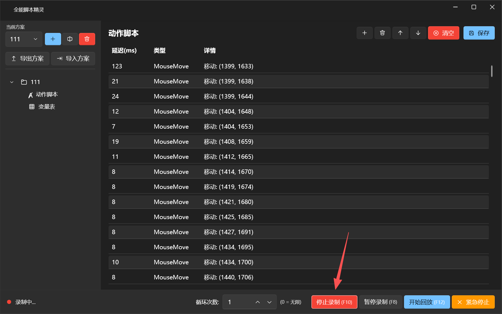

# 全能脚本精灵

全能脚本精灵是一款 Windows 桌面自动化工具，可以录制鼠标、键盘和窗口操作，也可以手动添加“看到图片就点击”“按键操作”“等待文字出现”“读取数据”等步骤。它适合把重复流程做成可复用脚本，比如等待按钮出现后点击、切换窗口、执行快捷键、读取接口数据后继续下一步。



## 下载

请到 GitHub 仓库的 [Releases](https://github.com/yehuili1/xiaoyedj-site/releases) 下载最新版单文件 exe。

当前版本：`v2.3.1`

下载后双击运行 `全能脚本V2.3.1.exe` 即可。

## v2.3.1 修复

- 修复框选目标时把灰色遮罩层截进目标图片的问题。
- 修复“测试识别”时软件自身窗口遮挡或污染识别画面的问题。
- 修复框选一次后“保存设置”触发 `DialogResult` 运行异常的问题。
- 框选坐标改为物理屏幕坐标，改善多显示器和系统缩放场景的准确性。

## v2.3.0 更新重点

- 首页重新设计为新手引导，先明确选择“普通脚本”或“监控任务”，不再把两种用法混在同一页。
- 新增真正的后台监控任务：识别指定图片、屏幕文字或窗口标题后，自动执行整套脚本动作。
- 图片监控支持直接框选当前画面作为目标，也支持从文件选择模板图；图片和文字监控均可限制扫描区域。
- 新增单次识别测试、匹配阈值、扫描间隔、连续命中次数和触发冷却设置。
- 监控采用顺序扫描，不会让多次识别重叠堆积；目标持续存在时只触发一次，目标消失并经过冷却后才重新布防。
- 监控过程中会自动暂停识别并执行脚本，执行结束后继续等待；托盘菜单可直接开始或停止监控。
- 最短扫描间隔为 `300 毫秒`，文字识别自动限制为至少 `700 毫秒`，并优先支持框选小区域以降低电脑负载。

## v2.2.10 更新重点

- 新增定时执行，可按方案设置“每隔几秒”“每隔几小时”“每天固定时间”或“只执行一次”；秒级间隔支持 `1–86400 秒`。
- 支持从指定序号开始播放，也可以右键某一步选择“从此步开始执行”。
- 迷你窗口新增动作延迟倒计时，并支持贴边吸附、自动隐藏和位置记忆。
- 加强图片识别对缩放、彩色图标、边缘特征和局部模板的适应能力，提升不同显示比例下的识别成功率。
- 录制鼠标动作时优先读取鼠标所在窗口，改善多窗口场景的回放定位。
- 停止录制覆盖已有方案前增加确认，减少误覆盖原脚本。

## v2.2.9 更新重点

- 新增“看到图片就移动”：识别到图片后只把鼠标移动到目标位置，不点击，适合先定位鼠标再执行下一步。
- “看到图片就移动”支持缩略图显示、延迟时间、超时时间、右键修改图片和“测试一下”。
- 优化图片识别命中速度，识别到合格结果后更快返回，减少动作 1 切到动作 2 时的停顿感。
- 图片识别失败时不再额外截图写错误日志，自动跳过更轻快。
- 图片点击和图片移动的超时时间支持设为 `0 秒`，表示只扫一次，没找到就立刻跳过。
- 新增图片移动动作后，迷你窗口会显示当前步骤说明和图片预览。

## v2.2.8 更新重点

- 动作列表右键新增“修改这一步”，支持直接修改插入文字内容、重新选择图片、重新捕捉按键、修改识别文字和窗口标题关键词。
- 插入录制补强鼠标拖动捕获，支持录制过程中鼠标拖动动作，并修复首段拖动可能漏掉鼠标按下的问题。
- 播放录制拖动时压缩中间轨迹，只执行拖动结果，避免鼠标逐点播放轨迹。
- 优化微信/企业微信窗口缩放后的坐标换算，改善窗口左右拉宽、上下拉高后的定位偏差。
- 图片识别和点击动作继续排除本软件窗口区域，避免误点迷你窗口里的缩略图。
- 图片识别失败时自动跳过当前图片动作并继续下一步。
- 插入文字改用原生剪贴板写入并缩短内部保护等待，减少动作之间的隐藏延迟。
- 图片点击、按键操作、插入录制等动作的执行等待进一步压缩，0 秒延迟时更接近立即执行。
- 全局热键过滤更严格，避免远程桌面或单独按 Ctrl/Alt/Shift/Win 时误触发录制、回放或插入录制。
- 发版产物改为单独一个主程序 exe，不再要求 zip 压缩包。

## v2.2.3 更新重点

- 新增“插入录制”：可以在任意步骤后插入一段鼠标键盘录制，列表中只显示为一条合并任务，内部保存完整录制动作。
- “插入录制”任务支持延迟时间和超时时间，执行到该任务时会按录制顺序继续执行后续动作。
- 新增“插入文字”：提前填写要粘贴的文本，脚本执行到这一步时自动写入剪贴板并粘贴到当前输入框。
- 工具栏简化为常用动作：插入录制、按键操作、插入文字、看到图片就点击、测试一下、清空、全局保存。
- 动作列表新增序号列，方便确认第几步正在执行。
- 动作顺序支持拖动调整，拖动时显示插入位置线，松手后移动，避免缩略图频繁闪烁。
- “看到图片就点击”识图时会自动排除本软件窗口区域，避免误识别迷你窗口里的预览缩略图。
- 图片未识别到时自动跳过当前图片动作并继续下一步。
- 优化录制片段的窗口匹配：窗口标题尾号变化时会按稳定标题匹配，并忽略小工具窗口，减少鼠标飞到错误窗口的问题。
- `F5` 不再默认触发“插入录制”，插入录制改为通过工具栏按钮打开；录制窗口内仍可用 `F10` 开始/停止录制。

## v2.2.2 更新重点

- “看到图片就点击”列表改成缩略图显示，点击缩略图可以放大预览。
- 图片动作不再显示自动生成的图片文件名，界面更干净。
- 时间列改成“延迟时间”在前、“超时时间”在后，并且可以直接点击每一行的时间进行修改。
- “看到图片就点击”默认延迟时间为 `1 秒`，默认超时时间为 `10 秒`。
- 添加图片点击动作时，先设置延迟时间，再设置超时时间。
- 添加完一张图片后，会提示是否继续添加下一张，适合连续添加多个图片点击步骤。
- 新增“按键操作”，点击后直接按下要执行的组合键即可自动识别，例如 `Ctrl+A`、`F5`、`Alt+F4`。
- 按键操作支持单独设置延迟时间和超时时间，默认延迟 `1 秒`、超时 `10 秒`。
- 动作列表支持右键单独删除某一步，也保留清空全部。
- “保存”改为“全局保存”，保存后会给出成功提示。
- “导出/导入方案”升级为“导出/导入全局配置”，会包含所有方案、方案设置、快捷键、图片模板等配置。
- 新增软件设置，可调整关闭软件时的行为，也可以设置开机自动启动。
- 关闭确认默认把“彻底退出软件”放在上方，“最小化到托盘”放在下方。
- 迷你窗口会显示当前正在执行的步骤；图片步骤显示预览图，按键步骤显示按键内容，双击可恢复主窗口。
- 方案快捷键采用两段式：不在目标方案时先切换方案，再按一次才执行；已经在目标方案时按一次直接执行。
- 鼠标录制优化了窗口缩放后的坐标换算，改善窗口宽度变化时的点击定位。
- 图片识别升级为 OpenCV 多尺度匹配，提高不同缩放场景下的识别稳定性。
- 支持本地 Windows OCR 文字识别：等待文字出现、看到文字就点击、读取屏幕文字。
- 支持框选识别区域，减少误识别，提高文字查找速度。
- 支持 HTTP/API 类动作：读取数据、提交结果、完成后通知。

## 主要功能

- 支持普通脚本和监控任务两种独立模式；监控任务可由图片、文字或窗口出现自动触发。
- 录制鼠标移动、点击、滚轮、键盘输入等操作。
- 按方案保存脚本，支持新建、重命名、删除。
- 支持循环次数和播放速度设置。
- 支持看到图片就点击、看到图片就移动、等待图片出现、等待窗口、切换到窗口。
- 支持按键操作，可自动捕获普通按键、功能键和常见组合键。
- 支持等待文字出现、看到文字就点击、读取屏幕文字。
- 支持读取接口数据、提交接口结果、执行完成后通知。
- 支持全局热键，包括开始/停止录制、暂停录制、开始/停止回放、紧急停止，以及为单个方案绑定快捷键。
- 支持导出/导入全局配置，迁移时可连同图片模板一起打包。
- 支持系统托盘和迷你模式，方便在自动化任务中查看当前执行步骤。
- 运行日志会记录回放、窗口、剪贴板、图片识别、文字识别等关键状态，便于排查问题。

## 快速使用

### 普通脚本：需要时由你启动

1. 首页点击“创建普通脚本”并填写任务名称。
2. 点击“开始录制”，完成目标操作后停止录制；也可以在脚本步骤里手动添加动作。
3. 检查动作顺序和延迟时间，点击“开始回放”测试。
4. 以后可以通过主界面、快捷键或定时任务启动。

### 监控任务：看到目标后自动启动

1. 首页点击“创建监控任务”并填写任务名称，软件会自动打开监控设置。
2. 选择触发方式：
   - 图片：点击“框选画面作为目标”，在屏幕上拖框截取要等待的按钮、图标或提示画面；也可以选择现有图片。
   - 文字：填写要等待的文字，可再框选文字大致出现的屏幕区域。
   - 窗口：填写窗口标题中的稳定关键词。
3. 点击“测试当前画面”。测试成功后保存设置。
4. 回到脚本编辑页，通过录制或手动添加，设置识别成功后要执行的整套动作。
5. 点击左侧第 3 步“开始监控”。状态变成“正在监控”后，可以把软件最小化到托盘。
6. 目标出现并连续命中设定次数后，软件会暂停扫描、执行整套动作，然后继续等待下一次目标出现。

建议先使用默认的 `800 毫秒` 扫描间隔和 `2 次` 连续命中。确实需要更快响应时再调整到 `300–500 毫秒`，同时框选尽量小的监控区域。

## 图片动作里的两个时间

- 延迟时间：图片已经出现在屏幕上之后，再等几秒才点击或移动鼠标。默认 `1 秒`。
- 超时时间：最多等图片出现多久，超过这个时间还没找到就自动跳过。默认 `10 秒`。
- 如果超时时间设为 `0 秒`，软件只扫一次屏幕，没找到就立刻跳过，适合追求速度的流程。

举例：延迟时间 `1 秒`，超时时间 `10 秒`。意思是软件最多找这张图片 `10 秒`；一旦找到了，不会马上点，而是再等 `1 秒` 才点击。

## 按键操作里的两个时间

- 延迟时间：执行到这一步后，先等几秒再按键。默认 `1 秒`。
- 超时时间：这一步最多允许执行多久。默认 `10 秒`。

举例：添加 `Ctrl+A` 后，软件会在执行到这一步时等待延迟时间，然后自动按下 `Ctrl+A`，完成后继续执行下一步。

## 热键

热键可在应用内设置。默认配置会保存在程序目录旁的 `hotkey_settings.json` 中。

建议至少设置：

- 开始/停止录制
- 暂停/继续录制
- 开始/停止回放
- 紧急停止

默认 `F5` 不再绑定“插入录制”，避免误触发。需要插入录制时，请点击脚本步骤工具栏中的“插入录制”按钮。

如果需要一键启动某个方案，可以在热键设置中为该方案单独绑定快捷键。方案快捷键是两段式逻辑：当前不在目标方案时，第一次按会切换方案；已经在目标方案时，再按一次就会执行。

## 全局配置

应用会在程序目录旁创建 `Profiles/` 目录保存方案数据。需要迁移软件配置时，优先使用应用内的“导出全局”和“导入全局”。

全局配置包会尽量包含：

- 所有方案
- 方案循环次数、播放速度等设置
- 每个方案的脚本步骤
- 图片点击和等待图片使用的模板图
- 全局快捷键设置
- 其他软件配置

如果某个方案引用了截图或模板图，导出全局配置时会一并打包，导入到另一台电脑后可以继续使用。

## 软件设置

点击左侧“设置”可以修改：

- 关闭软件时每次询问
- 关闭时彻底退出软件
- 关闭时最小化到托盘
- 开机自动启动

如果曾经勾选“不再提示”，也可以在这里改回其他关闭方式。

## 本地开发

开发环境：

- Windows
- .NET 8 SDK

构建：

```powershell
dotnet build AutoMacro.sln
```

运行自动测试：

```powershell
dotnet test AutoMacro.sln -c Release
```

发布 win-x64：

```powershell
dotnet publish AutoMacro\AutoMacro\AutoMacro.csproj -c Release -r win-x64 --self-contained true /p:PublishSingleFile=true /p:IncludeNativeLibrariesForSelfExtract=true
```

## 发版流程

1. 确认 `AutoMacro/AutoMacro/AutoMacro.csproj` 中的版本号已更新。
2. 执行 `dotnet build AutoMacro.sln`，确保构建通过。
3. 执行 `dotnet publish` 生成发布产物。
4. 将 `publish/全能脚本V版本号.exe` 作为 Release 附件。
5. 创建版本标签，例如 `v2.3.1`。
6. 在 GitHub Releases 创建同名版本，并上传单文件 exe 附件。

本仓库已忽略构建输出、发布目录、zip 包、日志和运行配置，避免把本机产物提交进源码仓库。
